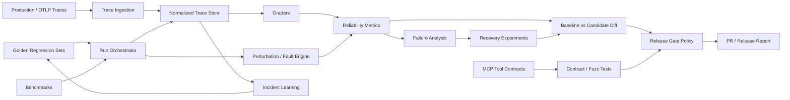

# Architecture

## Architectural principle

AgentProof is a **test/evaluation control plane**, not an agent runtime.
It should integrate with existing runtimes through adapters and traces.

## Interoperability

Prefer standards and portable artifacts:
- OTLP/OpenTelemetry for trace interchange,
- explicit benchmark adapters,
- MCP contract metadata for tool interfaces,
- JSON/Parquet run artifacts,
- versioned YAML release policies.
